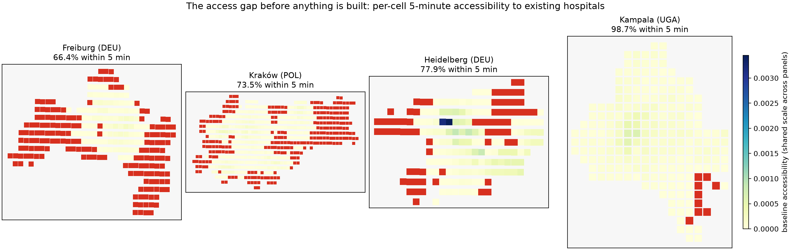
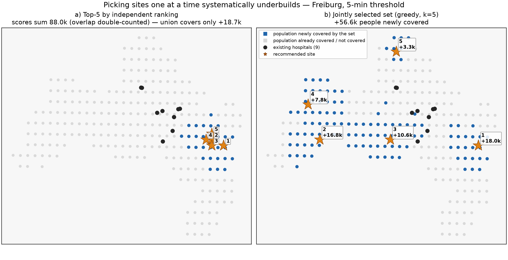
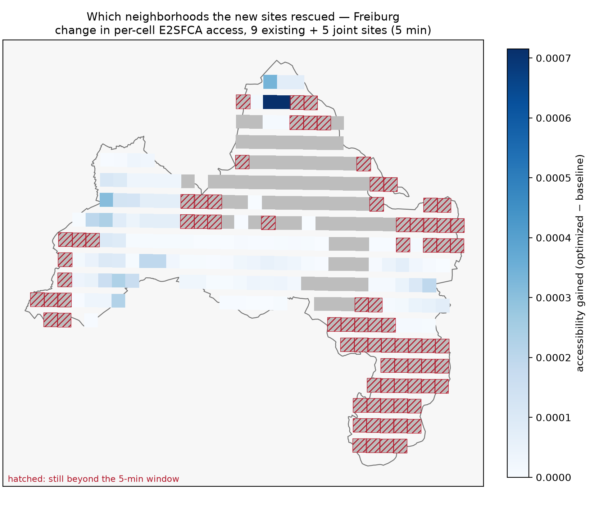
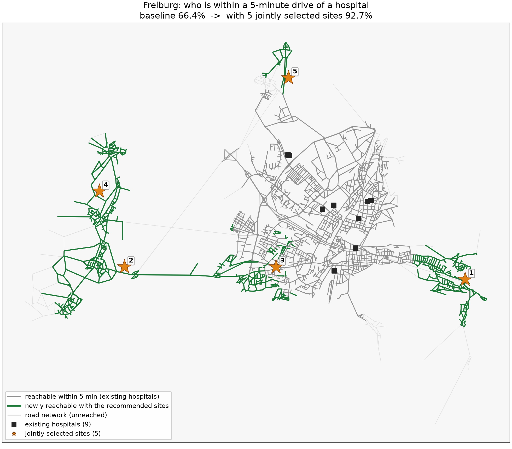

# Where Should the Next Hospital Go? A Drive-Time Case Study from Four Countries

> **ATLASIS v0.3 case study.** Non-technical companion to
> `docs/analyses/analysis-v0.3.md` (methods and full results). All figures
> are produced from committed code and cached open data — every number in
> this document is reproducible with the commands in the appendix.
>
> *Refreshed for v0.4: test count, demo/API status, and a drive-time
> calibration note. All result numbers are as computed in the v0.3 runs.*

---

## The problem in one sentence

SDG target 3.8 commits the world to **universal health coverage** — but a
hospital that exists on paper protects no one who cannot physically reach
it, and the distance between "exists" and "reachable" is exactly where
health systems quietly fail the poor.

Most planning tools answer *"how many facilities does this city have?"*
ATLASIS answers a harder, more human question: **"how many people can
actually get to one in time?"** — measured not as the crow flies, but along
real road networks, at drive time. The difference matters: in every city we
analyzed, the two answers disagree.

## What we built

ATLASIS is a fully open, fully free hospital-siting engine: type any city
name and it pulls the road network (OpenStreetMap), the population surface
(WorldPop), and the existing facility inventory, then recommends **where
new facilities should go so that the maximum number of people comes within
a fixed emergency drive time** (default 15 minutes; the interesting cases
live at 5 minutes). It runs in one command, on a laptop, with no paid data
or API — deliberately, because the cities where the access gap is largest
are usually the cities with the smallest planning budgets.

Under the hood sit three methods from the operations-research and health-
geography literature, assembled end-to-end and cross-checked against each other: **maximal coverage location (MCLP)** with a greedy solver carrying a
mathematical approximation guarantee, benchmarked against an exact MILP
solver (PuLP/CBC); the **enhanced two-step floating catchment
area index (E2SFCA)**, which turns binary "reachable / not reachable" into
a graded access surface; and **uncertainty reporting** (delete-1 jackknife
and seeded bootstraps) on every headline number. The suite of 137 offline
tests pins each known result to its documented value.

**The inputs are deliberately boring.** Road networks come from
OpenStreetMap (drivable edges only; edge travel time derived from mapped
speed limits, with a 40 km/h default where none is mapped). Population
comes from WorldPop's 1 km global density rasters, converted to per-cell
people counts and cropped to the city boundary — modeled totals land
within 1–8% of official figures wherever checked (Kampala ~1%,
Heidelberg ~4%, Kraków ~8%). Every distance is computed in the city's
local UTM projection, so meters and minutes mean what they say.

**Sites and facilities are constrained before anything is optimized.**
Candidate locations are a 500 m grid across the city boundary; hard
filters drop grid points within 800 m of an existing facility, more than
500 m from any drivable road, or inside forbidden zones (mapped water,
parks, cemeteries). The facility inventory is OSM's `amenity=hospital`
layer curated by physical evidence — mapped footprints and bed counts,
not name matching — so the same curation rules hold in German, Polish,
Kannada or Luganda. Full parameters and per-city data provenance:
`docs/analyses/analysis-v0.3.md`.

## Figure 1 — The access gap, before anything is built



> **Figure 1 —** per-cell baseline accessibility at the 5-minute threshold,
> Freiburg, Kraków, Heidelberg, Kampala. Red = beyond 5 minutes from any
> existing facility (or no road path at all); color = access graded by the
> E2SFCA surface, one shared scale across panels. One glance shows the gap
> is not a single missing hospital but a spatial structure — entire
> districts beyond the emergency window (Freiburg: most of the city).
>
> *Rendered by* `scripts/render_case_study_figures.py --figs 1` *from*
> `data/processed/{freiburg,heidelberg,krakow,kampala}/accessibility_baseline.gpkg`
> *(layer* `accessibility_baseline`, *column* `accessibility`, *per-city UTM
> CRS; the script cross-checks each panel against the documented baseline).*

## Findings

**1. Every city looks "covered" at 15 minutes — and none is at 5.**
At a 15-minute threshold every studied city sits at or near saturation —
the suite-wide pattern across all eight cities — which is precisely why
the naive question ("any hospital within 15 minutes?") is a dead end: it
saturates and hides the problem. Shorten the window to five minutes — a
meaningful bar for emergency care — and the picture inverts: baselines run
from **66% (Freiburg)** to **99% (Kolkata, Kampala)**. The lesson generalizes
beyond health: *coverage indicators must be tuned to the response time
that actually matters, or they will report success where there is none.*

| City (country) | Baseline 5-min coverage | After best single site | After jointly optimized set |
|---|---|---|---|
| Freiburg (DEU) | 66.4% | 74.8% | **92.7%** (k=5) |
| Kraków (POL) | 73.5% | 78.9% | **91.7%** (k=5) |
| Heidelberg (DEU) | 77.9% | 87.6% | **99.0%** (k=5) |
| Guwahati (IND) | 85.4% | 89.6% | **99.8%** (k=5) |
| Mysuru (IND) | 93.5% | 97.0% | **100.0%** (k=2) |
| Patna (IND) | 98.6% | 99.4% | **99.6%** (k=2) |
| Kampala (UGA) | 98.7% | 99.8% | **99.8%** (k=1) |
| Kolkata (IND) | 98.9% | 99.6% | **100.0%** (k=4) |

*All eight cities in the suite, sorted by baseline coverage; joint-selection
results in bold; each of the four new joint selections is confirmed optimal
by the exact MILP (gap 0.00% — the only greedy–exact gap in the suite is
Freiburg's 1.22%). The joint column's most telling pattern is that **the
optimizer knows when to stop**: Patna (k=2) and Kampala (k=1) stop well
under the 5-site budget because the only people left outside the window
have no road path to any facility — a network ceiling no additional budget
can lift (Kolkata stops at k=4 for the better reason: everyone is covered),
and Mysuru needs only two sites to reach full coverage. **Notes:** (1)
Mysuru's figures are defined against the 19 polygon-mapped facilities, a
deliberately stricter facility class — the full 85-facility network is
saturated even at 5 minutes (see analysis-v0.3.md). (2) Kampala's k=1 means
the best single site already exhausts all reachable uncovered population —
identical site, identical 99.8%. (3) **Calibration (v0.4):** the modeled
drive times were later validated against a real router in four of these
cities (50 OD pairs each, `docs/analyses/validation-v0.4.md`) — tag-rich
Freiburg and Kraków run ~24% optimistic (a modeled 5-minute window behaves
like ~6 minutes), tag-sparse Guwahati and Kampala show no usable correction
in either direction. Absolute percentages above therefore carry that scale
factor in tag-rich cities; the relative comparisons (before/after, joint vs.
ranked) are unaffected, since every scenario shares the same model.*

**2. Picking sites one at a time systematically underbuilds.** The
conventional approach — rank sites by individual benefit, take the top k —
reaches 74.8% in Freiburg; selecting the same number of sites *jointly*
reaches **92.7%**. The ranked list is also worse than it looks: its five
scores sum to +88.0k people, but spent as ranked, the same five sites
jointly cover only **+18.7k** — barely more than Rank-1 alone (+18.0k) —
because ranks 2–5 mostly double-count the pocket Rank-1 already covers.
Selected jointly, the same budget reaches **+56.6k**. The 18-point spread
between the two strategies is not better luck; it is the measurable cost
of ignoring overlap between candidate sites, and it grows with every site
added. For a planning office, "rank and pick" is not a neutral
simplification — it leaves the district that needed the facility second
still waiting. The optimizer also knows when to stop: **both solvers
return k=4** in Kolkata — greedy's early stop and the exact MILP's
optimum agree — because four sites already exhaust the city's reachable
uncovered population; a fifth would buy no one new coverage rather than
pad the budget.

## Figure 2 — What joint selection changes



> **Figure 2 —** Freiburg, 5-min threshold: (a) the top-5 sites by
> independent ranking vs (b) the jointly selected set of 5, each panel
> overlaid on the population cells the set newly covers. The ranking's five
> scores *sum* to +88.0k people — but they count the same uncovered pocket
> several times: spent as ranked, the union covers barely more than Rank-1
> alone (+18.7k). Selected jointly, the same budget reaches **+56.6k**, with
> visibly diminishing per-site gains (18.0k → 16.8k → 10.6k → 7.8k → 3.3k)
> — the signature of a set that stops duplicating coverage.
>
> *Rendered by* `scripts/render_case_study_figures.py --figs 2` *(rebuilds
> the coverage matrix and the greedy k=5 selection from the cached Freiburg
> data through the committed MCLP code; the objective is cross-checked
> against the documented 56,588).*

**3. Where to build changes who benefits.** The optimized sets are not
spread evenly: in Guwahati the best single site alone reaches 89.6%
(up from 85.4%; **+20,657 people** newly within 5 minutes) — but where the
gap is structural, only a joint set closes it: five jointly selected sites
bring **+70.1k people** inside the emergency window (99.8% coverage, the
suite's largest joint gain) and cut the worst-case drive time from
**11.5 to 5.3 minutes**. In Heidelberg
the joint sites cluster south-west
(Bergheim/Wieblingen direction), where the 5-min baseline is worst — and
the recommended set lifts city-wide coverage from 77.9% to **99.0%**, with
population-weighted median drive time improving from 3.1 to 2.5 minutes.
In Kraków the set lifts coverage 18.2 points
(73.5% → 91.7%, the best single site alone moving +40,751 people), and the
2SFCA access-intensity surface shows the new access concentrating exactly
where the sites landed (+20.0% on the population-weighted city index; in
Freiburg, per-cell access around the new sites nearly tripled).

## Figure 3 — The access surface after optimization



> **Figure 3 —** Freiburg, 5-min threshold: change in per-cell E2SFCA
> accessibility between the baseline (9 existing facilities) and the
> optimized scenario (9 + 5 jointly selected). Blue = access gained,
> grey = unchanged, hatched = still beyond the 5-minute window. This is the
> equity-relevant panel: it shows *which neighborhoods* the new sites
> rescued — 117 of 262 cells gained access — not just how the city total
> moved.
>
> *Rendered by* `scripts/render_case_study_figures.py --figs 3` *from*
> `data/processed/freiburg/accessibility_{baseline,optimized}.gpkg`
> *(identical cell sets, joined on geometry).*

**4. The numbers survive scrutiny — and we say where they don't.**
Jackknife and bootstrap intervals on the Kraków headline (a +40,751-people
gain) stay in the tens of thousands under all resampling schemes. The
demand surface is modeled, not censused — modeled totals land within
the documented 1-8% margin (Kampala ~1%, Heidelberg ~4%,
Kraków ~8%) — and the facility
inventory is OSM's, curated by structural evidence (footprints, bed
counts) rather than English name matching, exactly so the same pipeline
works in Kannada, German, Polish, Japanese or Luganda. The drive-time model
itself was externally validated after this case study was written — four
cities × 50 OD pairs against a real router, finding the systematic optimism
and the tag-rich/tag-sparse split documented in
`docs/analyses/validation-v0.4.md`. Every caveat is printed in the tools
themselves, not footnoted away.

> **Robustness note — the forbidden-zone filter.** The land-exclusion
> filter (water, parks, cemeteries) inherits a deliberately broad OSM tag
> set. Re-testing it on Heidelberg and Kraków with a tightened set (adding
> forests, wetlands, quarries, landfills) shrinks the candidate pool by
> 28% and 15% respectively — and changes none of the results: same top
> sites and scores, same best-site gains, same k = 5 joint selections, same
> 2SFCA surfaces (the only difference is one tie-broken Heidelberg site
> sliding to an adjacent grid point with equal gain). The published
> placements sit on unambiguously buildable land; details in
> analysis-v0.3.md.

## Figure 4 — The before/after in one image



> **Figure 4 —** the hero image for the public demo map: Freiburg's baseline
> 5-minute road-network catchment (grey) vs the catchment with the jointly
> selected 5 sites (green = newly reachable road), with the population grid
> and both facility sets. Coverage: **66.4% → 92.7%** of the city's
> ~215,800 people inside the emergency window.
>
> *Rendered by* `scripts/render_case_study_figures.py --figs 4` *from the
> slim road graph (`data/raw/freiburg/roads_*.parquet`) plus the greedy k=5
> selection recomputed on the cached coverage matrix; the public Leaflet
> demo consumes the same data through the jobs API shipped in v0.4.*

## Why this is replicable

No paid data, no proprietary solvers, no cloud dependencies: WorldPop
rasters, OpenStreetMap, OSMnx, PuLP/CBC, Python. Any government analyst,
student or NGO with a laptop can regenerate every number above for their
own city with one command — and the same engine already speaks four
countries' worth of tagging cultures. The barrier to running this analysis
should be a decision, not a procurement process; that is the point of
building it on open data.

---

## Appendix: reproduction

```bash
# Any city, any country — one command, < 10 min including downloads
python -m backend.main --city freiburg --place "Freiburg im Breisgau, Germany" \
    --threshold 300 --num-sites 5 --mode both --uncertainty
# Figure sources land in data/processed/<city>/:
#   top_sites.gpkg                        ranked + selected sites
#   accessibility_baseline.gpkg           per-cell E2SFCA, existing facilities
#   accessibility_optimized.gpkg          per-cell E2SFCA, with new sites

# The four figures above, offline from the cached exports:
venv/bin/python scripts/render_case_study_figures.py
```

*All four figures are rendered offline (matplotlib, no basemap service) by
`scripts/render_case_study_figures.py` from the GPKG exports above — the
script re-derives the joint k=5 selection through the committed MCLP code
and cross-checks every headline number against `analysis-v0.3.md`, printing
a mismatch rather than silently plotting one. The public demo map shipped
in v0.4 as the Jobs API + web UI (`python -m backend.api.app`).*
